# 新测试员快速上手

IVAD Platform 1.0.0-P2 · 全部正常操作通过鼠标和键盘完成。

先确认当前项目，再按下表完成一次“录像 → 片段 → 抽帧 → 人工标注”。P2 不是生产自动报警系统。

| 步骤 | 操作 | 简要说明 | 正文位置 |
| --- | --- | --- | --- |
| 01 | 启动 IVAD | 双击启动程序，进入开发模式 | 详见第 3 页 |
| 02 | 创建或打开项目 | 确认需要操作的选煤厂项目 | 详见第 3 页 |
| 03 | 导入监控录像 | 视频管理中导入 MP4、AVI 等录像 | 详见第 4 页 |
| 04 | 查找故障时间 | 播放、拖动时间轴或输入秒数定位 | 详见第 5 页 |
| 05 | 截取并保存故障片段 | 设置起止时间，保存独立短片段 | 详见第 6 页 |
| 06 | 自动抽帧 | 选择片段，设置间隔并确认任务 | 详见第 7 页 |
| 07 | 进入标注工作台 | 筛选录像，打开已抽取的图片 | 详见第 9 页 |
| 08 | 人工标注故障 | 画矩形框或多边形，选择故障类型 | 详见第 10 页 |
| 09 | 保存并检查标注 | 保存后重开图片，检查框与审核状态 | 详见第 12 页 |
| 10 | 反馈测试问题 | 截图、复制诊断信息，填写测试表 | 详见第 15 页 |

## 重要提醒

1. 建议初次测试先使用 20–60 秒短视频片段，不要直接处理数小时的完整录像。
2. 人工画框与故障分类是在建立训练数据，不代表 AI 已经学会识别故障。
3. 出现异常时，保存错误截图并通过“诊断日志”获取信息，不要自行删除项目数据。

详细操作从下一页开始。测试结果请填入配套 Excel 测试记录表。

> 页码指配套 Word 最终分页；Markdown 自身不分页。

# 第一章 软件简介

IVAD Platform 是用于整理监控录像和建立人工标注数据的软件。本指南适用于 1.0.0-P2，供选煤厂操作员和测试员通过鼠标、键盘完成操作。编制日期：2026 年 10 月 14 日。

当前 P2 用于录像管理、数据准备和人工标注。它不是已投入生产的自动报警系统。操作员仍须自行判断画面是否存在故障。

| 当前可使用 | 当前版本暂不支持 |
| --- | --- |
| 项目创建、打开、保存和一致性检查 | AI 训练、自动故障识别、生产报警 |
| 复制或引用录像、播放定位、人工保存 MP4 片段 | 实时摄像头、RTSP、PLC 联动 |
| 固定间隔及变化筛选抽帧、后台任务和日志 | AI 辅助抽帧、AI 预标注 |
| 矩形框、多边形、ROI、故障类别、审核与保存 | 片段再裁片段、保存后自动继续抽帧 |
| 已审核图片检查、冻结版本与数据集导出 | 部署安装包、完整的项目备份恢复界面 |

开发模式：本指南使用的项目、视频、标注和数据集功能入口。生产监控模式：当前显示规划页面，不进行真实监控或报警；测试时请返回开发模式。

贯穿示例：测试员培训项目／CAM-DEMO-01／操作练习区／演示输送机。使用自制“演示监控录像_300秒.mp4”，将 120–140 秒保存为“演示故障片段_120至140秒”。画面中的色块只用于操作演示，不是现场故障证据。首次现场试用仍建议使用 20–60 秒合法短录像。

示例录像位于本机交付目录的 artifacts → p2-guide → 素材 文件夹。导入时在文件选择窗口进入该文件夹；其他电脑可由测试负责人提供同一素材。

## 正文导航

启动和项目管理：第 3 页

视频导入与管理：第 4 页

播放与定位：第 5 页

保存故障片段：第 6 页

自动抽帧：第 7 页

标注工作台：第 9 页

人工标注与分类：第 10 页

完整操作示例：第 13 页

问题反馈：第 15 页

核验边界：正文按钮来自当前真实 GUI。文件选择框的打开已观察；自动核验采用已知测试文件路径返回值，Windows 原生选择框的最终提交未完整自动复测。取消、缺失引用及部分失败场景另列在验证记录中，不能视为本轮已通过。

# 第二章 启动软件和项目管理

## 2.1 启动和选择模式

操作目的：进入可以整理录像的工作界面。

1. 在交付目录中双击“启动IVAD.cmd”。不要移动启动文件或自行更改环境。

2. 等窗口出现，选择“开发模式”；确认左侧能看到“项目管理”“视频管理与抽帧”“标注工作台”。

正常结果：出现 IVAD Platform 1.0.0-P2 窗口。

常见问题：窗口未出现或提示已有实例时，不要连续双击。先检查是否已有 IVAD 窗口；保留提示交给开发人员。

## 2.2 新建或打开项目

操作目的：把本次测试文件和结果保存在独立测试项目中。

1. 进入“项目管理”，填写“项目名称”“厂区信息”“项目描述”。练习项目命名为“测试员培训项目”。

2. 点击“新建项目…”，在弹出的“选择项目存储父目录”窗口选择允许存放测试数据的文件夹，点击“选择文件夹”。软件会建立自己的项目子目录。

3. 已有项目点击“打开项目…”，选择原项目文件夹；也可双击最近项目列表。无需编辑项目内文件。

4. 核对界面的项目名称、厂区和当前项目信息；修改说明后点击“保存配置”。必要时点击“一致性检查”。

正常结果：项目打开后，视频、标注等页面可以使用；检查结果显示 PASS 或列出问题。

常见问题：不要把打开项目当作新建项目。项目目录不完整、检查提示问题时，截图并联系开发人员，不要删除数据库或创建同名替代项目。

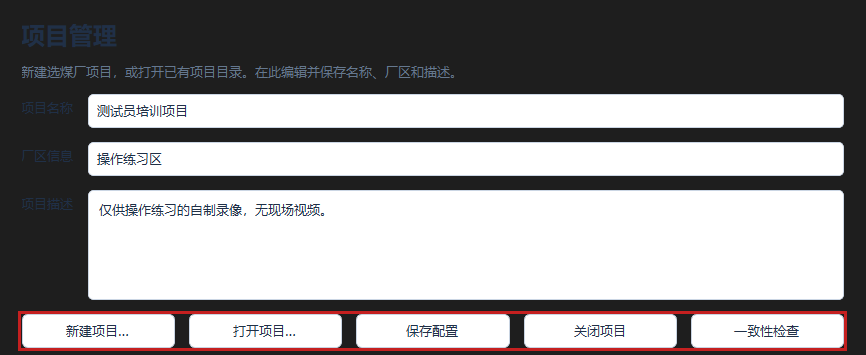

图 1 项目管理页面，红框为新建、打开和项目操作区。

## 2.3 安全关闭

操作目的：保留已经完成的工作。

1. 标注时先点击“保存标注”，等出现“已保存”。在“任务中心”确认是否有正在执行的任务。

2. 需中止时使用对应取消按钮，等任务结束；然后点击“关闭项目”或窗口右上角关闭按钮。

正常结果：窗口正常关闭，已保存的项目可重新打开。

常见问题：不要用断电、强制结束进程代替正常关闭。保存失败提示未解决时，先记录错误；“放弃修改并重载”会丢弃尚未保存的修改。

# 第三章 视频导入与管理

操作目的：把录像纳入当前项目，并确认可以访问。

1. 进入左侧“视频管理与抽帧”。在左上方选择“复制到项目（默认）”或“外部引用”。

2. 点击“导入信息（可选，展开/收起）”，可填摄像头编号、厂区、设备；示例填写 CAM-DEMO-01、操作练习区、演示输送机。

3. 点击“批量导入录像…”，在“批量选择监控录像”中选择 MP4、AVI、MOV、MKV。按 Ctrl 可选择多个文件，再确认打开。

4. 等待后台导入；在左侧列表选中录像，核对“录像、方式、状态、时长、编码、分辨率”。

正常结果：导入完成显示 READY；选中高亮，右侧显示该录像和处理范围。

常见问题：扩展名正确不保证编码可解码。失败时看“任务中心”与“诊断日志”，不要改扩展名冒充可播放文件。

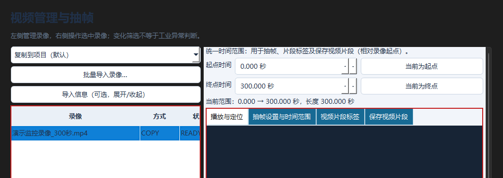

图 2 左侧为可滚动录像列表，右侧为选中录像的操作区。

| 标记 | 操作员应理解的含义 |
| --- | --- |
| COPY | 项目内保存视频副本，占用磁盘空间。原录像内容保持不变。适合测试和交接。 |
| REFERENCE | 只记录外部原文件位置，节省副本空间。原文件移动、删除或外接盘断开后不可访问。 |
| READY / IMPORTING | READY：导入已完成且文件可访问；IMPORTING：导入中。READY 仍不保证播放器一定正常。 |
| MISSING / ERROR / CANCELLED | MISSING：记录对应文件找不到；ERROR：导入或解码出错；CANCELLED：任务取消。媒体状态不叫 FAILED。 |
| 任务 FAILED | 这是“任务中心”的失败状态，查看任务日志；不要与媒体列表的 ERROR 混淆。 |

列表可用鼠标滚轮上下浏览，用底部横向滚动条查看右侧列；可拖动列头边界增宽“录像”列。中间分隔条可调整左右宽度。右侧空间不足时纵向滚动；蓝底白字为普通标签，白底黑字为悬停或激活标签。

重复导入相同内容时复用已有资源，不应期待列表新增一份。引用缺失可选中该条后点击“重新定位引用…”并选择原文件；只允许同一内容的文件。此异常恢复路径本轮未完成 GUI 复测。COPY 缺失请保留整个项目，交给开发人员恢复。

# 第四章 视频播放与定位

操作目的：人工寻找需要保留的故障时间范围。

1. 在左侧选中 READY 录像，点击右侧“播放与定位”。

2. 点击“播放”；播放中同一按钮变为“暂停”，需要仔细观察时暂停。

3. 拖动播放器下方时间轴；也可在跳转秒数输入框输入 120，再点击“跳转”。

4. 点击“上一帧”“下一帧”逐帧观察。速度下拉框可选 0.25×、0.5×、1×、2×、4×。

5. 定位异常之前，点击上方“当前为起点”；定位异常结束之后，点击“当前为终点”。也可直接输入“起点时间”“终点时间”。

6. 核对“当前范围”起止秒数和长度。示例设为 120.000 → 140.000 秒，长度 20.000 秒。

正常结果：画面随播放、时间轴或跳转更新，统一时间范围显示正确。

常见问题：跳转会落在实际存在的视频帧，不保证任何小数秒都有画面。播放不含音频；卡顿时先暂停并用跳转或逐帧检查。

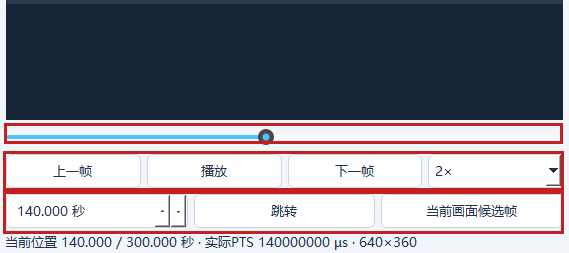

图 3 播放器下方的时间轴、逐帧、播放速度与跳转按钮；起止设置见图 4。

这里的秒数是从本视频开始计时的相对时间，不是摄像头画面中叠加的日期和时钟。摄像头时间是否准确由录像来源决定，软件显示“真实拍摄时间未知”时不能将两者混用。

“当前画面候选帧”可保存当前画面供人工标注；它与按范围后台抽帧不同。保存视频片段也不会自动生成候选图片。切换录像后范围会重置，请重新核对，不要沿用上一段录像的设置。

寻找故障时可先快速播放，再在疑似时间前暂停，用逐帧观察确定范围。给故障开始前、结束后保留一点正常画面，便于后续对照；不要把不确定画面直接当作已确认故障。

# 第五章 人工截取故障片段并保存

操作目的：保留一个可独立播放、抽帧和标注的短视频，原始长录像仍保留。

1. 选中原始录像，而不是已有 CLIP。播放找到异常前的位置，点击“当前为起点”。

2. 找到异常后的画面，点击“当前为终点”。确认终点晚于起点、不超过总时长。示例为 120–140 秒。

3. 点击“保存视频片段”标签，填写“片段名称”：演示故障片段_120至140秒；“备注”可填操作练习或故障说明。不填名称时采用默认命名。

4. 点击标签内的“保存视频片段”按钮。进入“任务中心”观察进度和状态；等待 SUCCEEDED。

5. 返回视频管理，找到标有 CLIP 的新资源并选中。切回“播放与定位”，点击“播放”检查内容和长度。

6. 要继续抽帧，选中新 CLIP，再进入“抽帧设置与时间范围”，按第六章另行提交任务。

正常结果：本例生成约 20 秒独立 MP4；列表有新 CLIP，能实际播放。原录像校验值在核验前后相同。

常见问题：保存失败显示 FAILED 时查看任务日志，不把失败任务当成已生成片段。列表没有新 CLIP 时先确认选中的是正确项目、任务是否成功。

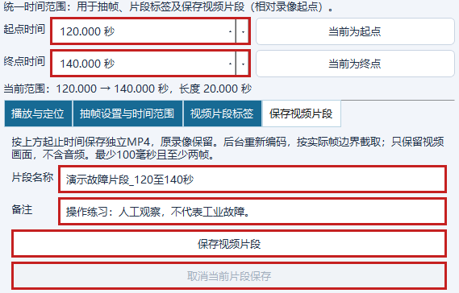

图 4 保存视频片段标签，红框标出命名、备注和保存按钮。

保存规则：即使原录像为 REFERENCE，片段也作为 COPY 实际文件保存在项目 media 文件夹。磁盘文件使用唯一编号，未必等于显示名称。项目记录保留片段唯一 ID、父视频来源、请求起止时间、实际帧边界、生成时间和文件位置。测试员通过列表使用片段，不必手动管理文件。

同一原录像有多个故障：再次选中原始录像，重新定位另一范围，填写可区别的片段名称，重复保存；各片段独立存在。

范围至少 0.100 秒且含两帧；过短、倒序或越界时扩大或更正范围再保存。裁剪按照实际画面边界重新编码，可能与输入时间略有差异；只保留视频画面，不保留音频。

取消时点击“取消当前片段保存”，等任务变为 CANCELLED；完成和取消存在先后关系，若已 SUCCEEDED，则检查已完成片段。不得手动删除原视频。取消异常场景本轮未重新进行 GUI 验证。当前版本暂不支持“保存并继续抽帧”和“片段再裁片段”。

# 第六章 自动抽帧操作

操作目的：把指定时间范围变成候选图片，供人工筛选与标注。先选中录像或 CLIP，再设置右侧上方范围，打开“抽帧设置与时间范围”。下表说明当前真实参数。

| 参数 | 含义与调整时机 | 影响与常见误操作 |
| --- | --- | --- |
| 起点时间 / 终点时间 | 从哪里开始、到哪里结束，单位秒。故障片段自身从 0 秒计时。 | 先选视频再填；终点要晚于起点且不超过时长。 |
| 抽帧方式：固定间隔 | 按相同时间间隔均匀取图，适合初次试用。 | 不要误选“AI辅助 · Not Available（P5）”，该项不能运行。 |
| 变化筛选（非AI） | 按画面变化筛选候选，结果数量随内容变化。 | 变化筛选不等于工业异常判断；相机晃动或光照改变也会入选。 |
| 固定间隔 / 频率 | 秒/帧：1.000 表示约每秒一张；0.200 表示约每秒五张。 | 允许 0.001–3600 秒/帧；越小通常图片越多，受原视频帧率限制。 |
| 张数上限 | 本次最多生成的候选图片数量，达到后停止。 | 允许 1–5000，默认 50；漏改上限可能只抽到前半段。 |
| 输出格式 PNG / JPEG | PNG 无损，通常较大；JPEG 压缩，通常较小。 | 根据磁盘空间和图像细节需求选择；不是视频输出格式。 |
| JPEG质量 | 仅 JPEG 生效，1–100，默认 90。 | 数值越大通常越清晰、文件越大；PNG 时灰显正常。 |
| 输出最大宽度 | 0 表示原始显示分辨率；非零值等比例缩小。 | 允许 0–8192；不会放大原图。过小可能看不清细小故障。 |
| 变化阈值 | 变化筛选的敏感程度，0.1%–100%。 | 越小越敏感、候选可能更多；不是故障概率，固定间隔模式无需调整。 |
| 保留固定间隔基础样本 | 变化筛选时同时保留均匀样本。 | 初次建议勾选，便于保留正常画面对照；仍受张数上限限制。 |
| 确认范围并后台抽帧 | 按所选视频、范围和参数提交后台任务。 | 确认窗口点击 Yes 开始，No 返回；确认后到任务中心查看进度。 |
| 取消当前录像抽帧 | 只取消当前选中录像的抽帧任务。 | 按钮灰显通常表示没有可取消任务；已完整保存的图片会保留。 |

正常结果：任务中心显示 SUCCEEDED，标注工作台出现候选图片。常见问题：零张不等于视频正常；先核对范围、上限、变化筛选设置以及任务错误信息。不要把抽帧结果当成自动故障诊断。

# 第六章 抽帧案例与任务确认

## 6.1 案例 A 普通录像均匀抽帧

操作目的：均匀浏览 5 分钟录像。

1. 选中“演示监控录像_300秒.mp4”，设置范围 0–300 秒。

2. 选择“固定间隔”，间隔 2.000 秒/帧，上限 150 张，PNG，输出最大宽度 0。

3. 点击“确认范围并后台抽帧”，确认窗口点击 Yes；到任务中心等 SUCCEEDED。

正常结果：本例实测生成 150 张图片。

常见问题：实际数量取决于视频帧和时间范围，不能只用时长除以间隔保证张数。不要保留默认上限 50 后又期待 150 张。

## 6.2 案例 B 故障片段密集抽帧

操作目的：为人工标注准备更密集的故障画面。

1. 选中“演示故障片段_120至140秒”CLIP，范围设 0–20 秒。

2. 选择“固定间隔”，间隔 0.200 秒/帧，上限 100 张，JPEG，质量 90，输出最大宽度 0。

3. 确认并后台抽帧，等待任务完成，再进入标注工作台。

正常结果：本例实测生成 100 张候选图片。

常见问题：片段时间从 0 开始；不要再次填原录像 120–140 秒。保存片段完成后仍需提交抽帧任务。

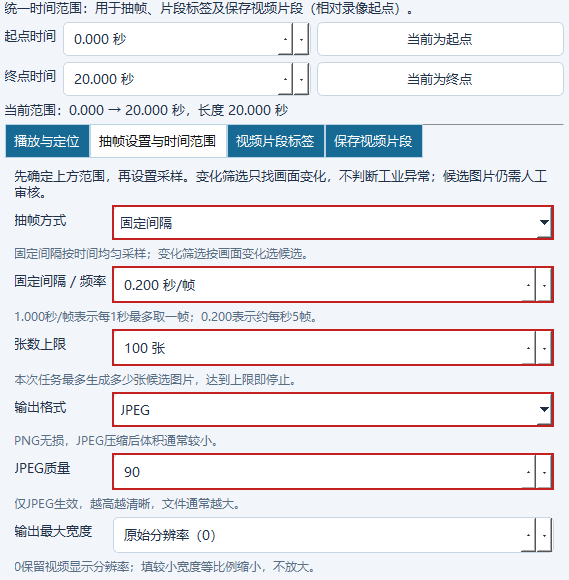

图 5 当前抽帧页面的参数与中文辅助说明。

图 6 真实确认窗口，Yes 开始任务，No 返回。

# 第七章 进入标注工作台

操作目的：打开已抽取的候选图片，确认来源后开始人工标注。

1. 在“任务中心”确认抽帧 SUCCEEDED。保持当前项目打开，点击左侧“标注工作台”。

2. 左上来源下拉框默认“全部来源”，也可选“录像 + 8 位编号”。这是媒体编号，列表目前不显示完整录像名称。

3. 点击左侧第一张图片。每项包含视频相对秒数和图片短编号；核对底部 PTS、图像尺寸和版本信息。

4. 点击“下一张”“上一张”切换；鼠标滚轮缩放，中键按住拖动平移，“适应窗口”恢复完整画面。

正常结果：候选图片显示在画布上，左右切换可打开同一项目的其他图片。

常见问题：没有图片时先确认项目及抽帧任务；只保存片段不会生成图片。列表含 Missing 时，不要继续标注缺失文件。

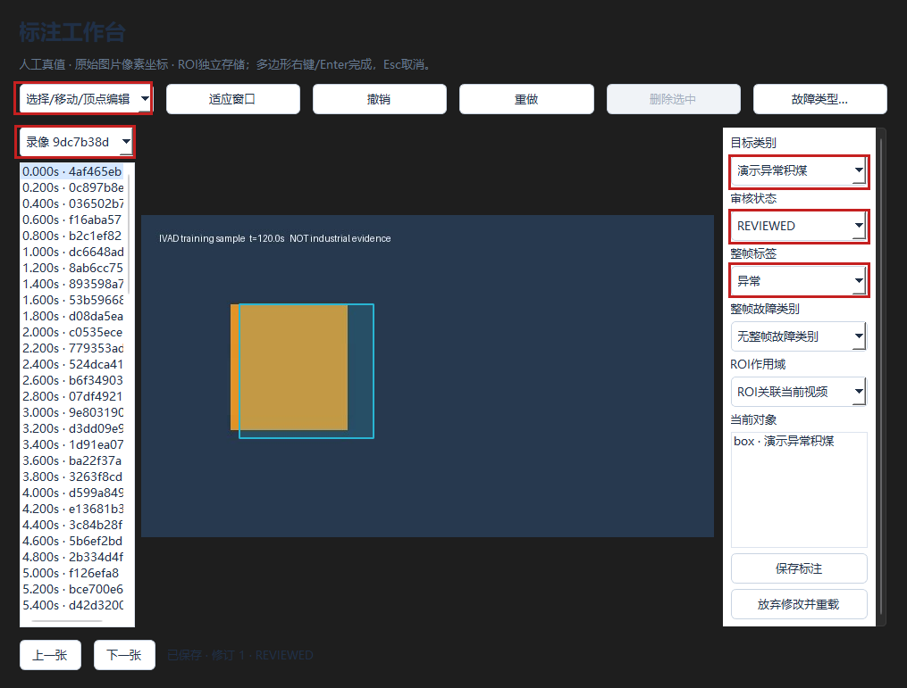

图 7 标注工作台的来源筛选、图片列表、画布和右侧属性区。

当前无需另选项目或手工导入图片集，工作台使用已经打开的项目。视频管理切换录像不会保证工作台自动选中同一来源，必须检查工作台来源下拉框。

来源追溯限制：当前工作台只显示录像短编号、图片相对时间与 PTS，没有完整原视频名称或父录像时间换算面板。多录像测试时，请在测试记录中保留视频名称、片段范围和界面显示的短编号；无法确定来源时先停止，向开发人员核实。不要凭缩略图猜测来源。

本例选择刚生成片段的来源编号，再打开 0.000 秒图片。片段的 0 秒与原录像请求范围 120 秒有关，但实际取帧边界可能略有偏移。不得把“120 + 片段时间”当成精确摄像头拍摄时刻。

抽帧图片在项目内管理。正常测试通过工作台打开即可，不需要进入文件夹搬运图片。

# 第八章 人工标注与故障分类

## 8.1 故障类型管理

操作目的：建立或选用统一的人工故障名称。

1. 点击工作台上方“故障类型…”，打开“故障类型与标签库”。

2. 选择已有类别检查说明；需要新类别时点击“新类别”，填写名称、描述、设备等信息，保持启用，点击“保存类别”。示例新建“演示异常积煤”。

3. 点击“关闭”，回到工作台，在“目标类别”选择刚保存的类别。

正常结果：类别出现在目标类别下拉框；已有类别改名不会改变其身份编号。

常见问题：名称应经现场负责人统一。已被引用的类别不能用“删除未引用类别”删除；不要把停用类别当作新类别重复创建。

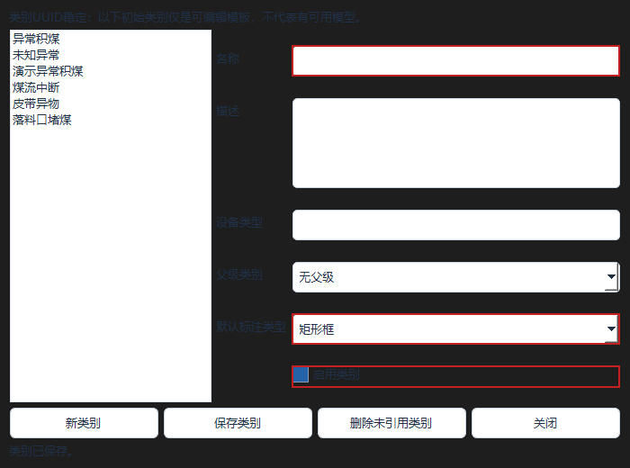

图 8 故障类型与标签库，红框标出类别管理操作。

## 8.2 矩形框

操作目的：给画面中的一个故障目标划定范围。

1. 在“目标类别”选择故障类型，工具下拉框选择“矩形框”。

2. 在画布内按住鼠标左键，从目标一角拖到对角，松开形成框。

3. 切换“选择/移动/顶点编辑”，点击框；拖动框移动，拖角点调整大小。

4. 画错时选中对象，点击“删除选中”；需要回退可用“撤销”，恢复用“重做”。

正常结果：框覆盖目标，当前对象列表与类别一致。

常见问题：不要把屏幕缩放后的坐标当作图像像素手工输入。框偏移时用“适应窗口”检查，保存重开仍偏移则截图反馈。

正常画面可将“整帧标签”选为“正常”，不必制造故障框。不确定时选“未知/待确认”，保持 DRAFT 等待审核；已确认异常可选“异常”，必要时选择“整帧故障类别”。目标类别用于某个框，整帧类别用于整张图片，二者分别检查。

# 第八章 多边形与 ROI 区域

## 8.3 多边形标注

操作目的：标出不规则形状的目标。

1. 选择故障类型和“多边形”工具，沿边缘用左键逐点点击，至少三个有效点。

2. 按 Enter 或右键完成；Esc 取消尚未完成的绘制。

3. 切回“选择/移动/顶点编辑”，选中多边形，拖动顶点修正；选中后可删除。

正常结果：完整闭合多边形显示并可以编辑。

常见问题：不支持复杂孔洞或任意分割画笔；过少点、交叉或无效形状提示时重新绘制。

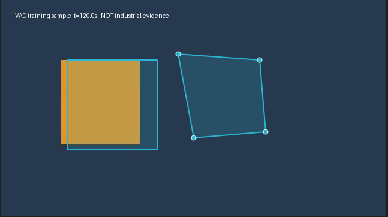

图 9 真实绘制的矩形与多边形对象。

## 8.4 ROI 区域

操作目的：保存需要关注的区域，供同一视频或摄像头重新使用。

1. 在“ROI作用域”选择“ROI关联当前视频”或“ROI关联摄像头”；后者需有摄像头编号。

2. 选择“矩形ROI”拖动绘制，或“多边形ROI”逐点后按 Enter 完成。

3. 点击“保存标注”，等已保存，再切换图片或重开同一图片检查区域。

正常结果：ROI 独立保存，按选定视频或摄像头作用域加载。

常见问题：ROI 是观察区域，不是故障目标，不会作为普通目标框直接导出训练标签。切换作用域会加载该作用域，请先保存。

# 第八章 保存与审核

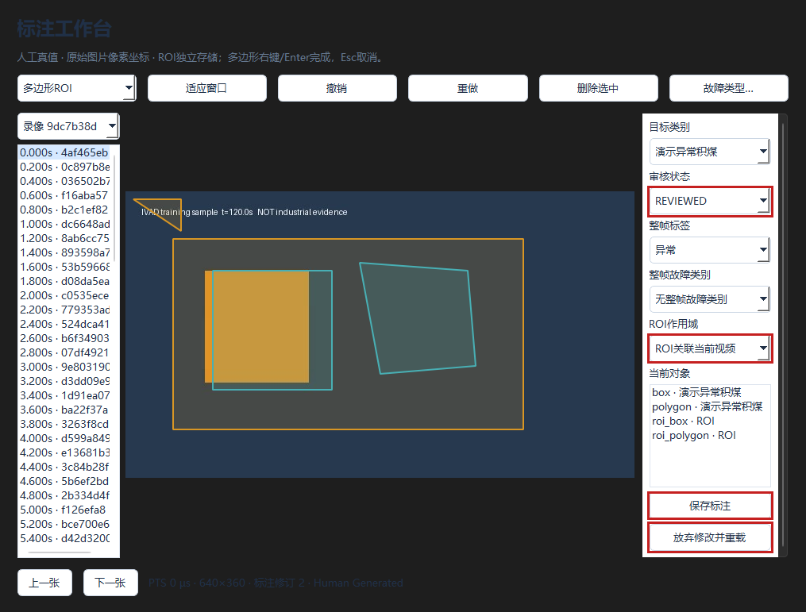

图 10 ROI 与右侧审核和保存区。

## 8.5 保存与审核

操作目的：确保标注能够恢复并明确人工审核状态。

1. 核对类别、框或顶点、整帧标签；初稿用 DRAFT，已人工检查用 REVIEWED，正式批准用 APPROVED，退回用 REJECTED。

2. 点击“保存标注”，等待底部“已保存”及版本更新；软件也会延迟自动保存，不要在错误提示时直接离开。

3. 切换下一张再返回检查。修改历史标注后再次保存；测试结束正常关闭并重开项目复查。

正常结果：标注、ROI 与审核状态保持；已审核状态可用于数据集选择。

常见问题：保存失败时停止切换并复制日志。只有确实愿意丢弃未保存修改，才点击“放弃修改并重载”。人工标注是在建立训练数据，不代表 AI 已学会识别故障。

# 第九章 完整操作示例

操作目的：在同一个“测试员培训项目”中走通原录像 → 片段 → 抽帧 → 人工标注 → 保存。用自制示例学习按钮路径；现场测试请使用获准的录像。

| 步骤 | 实际操作 | 正常结果 |
| --- | --- | --- |
| 1 | 按第二章启动、创建或打开测试员培训项目。 | 项目名称与厂区正确。 |
| 2 | COPY 导入演示监控录像_300秒.mp4，填写 CAM-DEMO-01。 | 视频列表 READY。 |
| 3 | 播放与定位：跳转 120 秒，当前为起点；跳转 140 秒，当前为终点。 | 当前范围长 20 秒。 |
| 4 | 保存视频片段：名称演示故障片段_120至140秒，填写备注后保存。 | 任务 SUCCEEDED，新增 CLIP。 |
| 5 | 选中 CLIP，播放确认；范围 0–20 秒，固定间隔 0.200，上限 100，JPEG 90，宽度 0。 | 确认 Yes 后实测 100 张。 |
| 6 | 标注工作台：按片段媒体短编号筛选，点击第一张。 | 0 秒图片显示。 |
| 7 | 故障类型…：新建演示异常积煤；目标类别选择该项，矩形框拖画。 | 框位置与类别正确。 |
| 8 | 整帧标签选异常，检查后设 REVIEWED，保存标注。 | 已保存；上一张/下一张重开仍在。 |
| 9 | 正常关闭并重开项目复查，填写测试记录表。 | 记录真实结果、问题和截图位置。 |

常见问题：如果没有 CLIP，先查保存任务；如果没有图片，先查抽帧任务；如果来源编号不明确，先核对并记录，不能跳过检查。一个步骤失败时，不要继续把后续步骤填写为 PASS。对应截图见图 1–10。

## 9.1 可选的数据集检查和导出

操作目的：交付人工检查过的图片与标注，不启动训练。

1. 进入“数据集管理”，点击“全选已审核图片”和“检查选择”。

2. 确认划分方式及比例，按原始来源或摄像头分组可降低同源数据混入不同组的风险。点击“冻结新版本”。

3. 选中冻结版本，选择当前支持的导出格式，点击“导出选中冻结版本…”，选择输出父目录并等任务完成。

正常结果：本轮实际完成冻结及 YOLO Detection 导出。

常见问题：少量或只有一个来源的样本可能提示训练/验证/测试组不足；不要为消除警告乱改标签。YOLO Segmentation 要求有效多边形，不能把矩形对象当作分割真值。导出不等于训练。

图 11 选中冻结版本后使用的导出格式与按钮。

# 第十章 常见问题与故障处理

操作目的：先保护项目和原录像，再定位问题。操作步骤：停止重复点击，核对当前项目、选中资源、参数与任务状态，再按下表检查。正常结果：能解释原因或形成可复现的问题记录。常见问题：直接删除项目文件会破坏恢复条件，请勿自行清理。

| 现象 | 检查与处理 |
| --- | --- |
| 视频无法导入 | 核对支持格式与文件可读性、磁盘空间；打开任务中心查看导入任务，再复制诊断信息。扩展名不能代表解码一定成功。 |
| READY 但无法播放 | READY 主要说明导入和文件访问状态。选中后检查右侧错误，尝试原播放器验证源文件；保留文件和日志交开发人员，不改编码环境。 |
| 重复导入没有新条目 | 相同内容会复用已有媒体。查找已有条目，不反复导入；需要不同故障片段请从原录像分别保存。 |
| 时间轴或跳转不够准确 | 显示按真实视频帧时间定位。暂停后逐帧看；区分相对秒数与画面摄像头时钟，记录目标秒数及实际显示。 |
| 抽帧数量为零或偏少 | 核对所选录像、起止时间、间隔、张数上限、方式。变化筛选不保证每个时刻有图；先用固定间隔短范围复试并看日志。 |
| 抽帧任务 FAILED | 选中任务查看任务日志，复制错误；先排查文件访问和有效范围。不要把 FAILED 写成“没有异常”。 |
| 保存片段后找不到文件 | 先确认任务 SUCCEEDED、项目正确，列表找 CLIP 并播放。项目 media 内文件名是编号，不必按显示名称寻找。失败或取消不算保存成功。 |
| 标注图片无法打开 | 核对项目与来源筛选、任务完成状态；Missing 说明文件缺失。运行一致性检查，保留整个项目联系开发人员，不重新生成文件冒充原图。 |

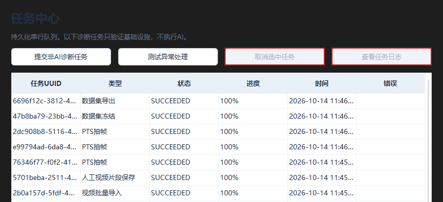

图 12 任务中心显示进度、状态及任务日志入口。

取消任务：使用视频页“取消当前录像抽帧”“取消当前片段保存”，或任务中心选中对应任务点击“取消选中任务”。等待状态变化，已完成结果可能保留。FAILED 与 CANCELLED 不同；断电等中断可能显示 INTERRUPTED。此类异常取消与中断路径本轮未重新实测。

# 第十章 保存问题与测试反馈

| 现象 | 检查与处理 |
| --- | --- |
| 标注框偏移 | 点击适应窗口，检查目标类别与框位置；重新打开同一图片比较。仍偏移时保存前后截图、图片短编号和缩放操作。 |
| 新故障标签未显示 | 确认在故障类型与标签库点过保存类别且处于启用状态，关闭标签窗口后检查目标类别。不要仅填写名称就离开。 |
| 标注保存失败 | 留在当前图片，查看底部错误和诊断日志；记录项目、图片短编号、动作。不要切换或用放弃修改按钮掩盖失败。 |
| 重新打开后数据不见了 | 先确认打开的是原项目目录和同一来源/图片，核对审核筛选。若此前未显示已保存，可能修改未落盘；保留整个项目和日志交开发人员。 |

## 10.1 收集诊断信息并反馈

操作目的：把问题交给开发人员，避免现场重复猜测。

1. 截图保留完整提示、相关按钮和画面，发送前遮住现场隐私信息。

2. 进入“诊断日志”，点击“复制诊断信息”；需要任务详情时到“任务中心”选中任务，点击“查看任务日志”。

3. 把复制的文本保存到允许的测试记录位置；在测试表记录截图和日志文件位置，不要把敏感原录像随意公开。

4. 填写问题描述、复现步骤、预期与实际结果、严重程度，以及项目/录像/片段范围和图片短编号。

正常结果：开发人员能按记录重现；原项目与原录像仍保留。

常见问题：当前没有一键提交工单或一键导出整个诊断包；使用复制信息与截图即可。操作员不需要命令行。

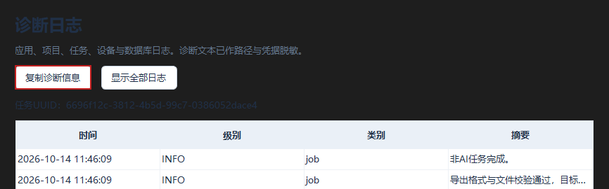

图 13 诊断日志中的复制诊断信息按钮。

## 10.2 填写测试记录表

“功能测试清单”：逐项执行后填写实际结果、状态、测试员和日期。PASS 表示满足预期；FAIL 表示实际错误；BLOCKED 表示前置条件或环境阻断；NOT TESTED 表示尚未执行。模板没有把本次编制核验结果冒充其他测试员结果。

“问题反馈”：一个可独立复现的问题占一行，记录截图或日志位置及处理状态。“测试环境”：填写电脑型号、Windows 版本、IVAD 版本、视频格式及分辨率、项目和日期。表头可筛选并已冻结，状态列有下拉选项。

本指南的验证记录另见 reports/P2_USER_GUIDE_VALIDATION.md。发现需求与实际软件不一致时先记录，等待用户决定是否修复。完成本轮测试后停止，不进入 P3。
