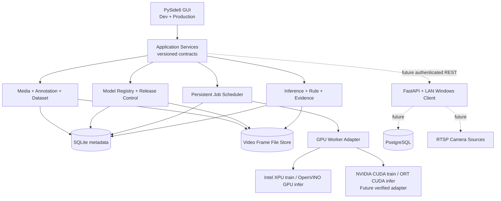

# IVAD Platform v1.0 — 系统架构设计

版本 1.0.0；2026-10-12；与 `SRS.md` 决策 D01–D10 一致。

## 1. 设计准则
**One UX, modular internals.** 单一 Windows GUI、开发/生产双工作空间、离线优先、API-Ready、GPU-only AI、插件式模型适配、数据与模型可追溯、训练和生产隔离。不在 P0 生成完整平台；P0 是有退出条件的硬件探针。

## 2. 逻辑拓扑


## 3. 推荐代码结构（规划结构，非现有文件）
```text
ivad/
  app/                 # 启动、依赖注入、配置
  gui/                 # PySide6 GUI: development / production workspaces
  domain/              # 实体、事件、规则、状态机（不引用 Qt/数据库）
  services/            # 项目、视频、标注、训练、模型发布、报警
  contracts/           # 版本化 DTO、接口与错误码
  repositories/        # SQLite 实现；PostgreSQL 接口预留
  storage/             # 文件索引、哈希、相对路径、备份恢复
  video/               # FileVideoSource、未来 RTSPVideoSource
  annotations/         # bounding box, polygon, mask, ROI, frame/clip
  datasets/            # exporters、splitting、manifest
  ml/
    adapters/           # Ultralytics YOLO / non-YOLO abstract base
    runtime/            # OpenVINO, torch_xpu, future cuda
    conversion/         # weights -> deployment artifacts
  scheduler/           # job persistence、GPU resource reservation、cancel
  detection/           # inference runner、tracking/time window、rules
  events/              # evidence writer、review queue
  api/                 # Future REST adapter (not exposed in v1)
  tests/
```

## 4. 关键设计契约
- `VideoSource.open/read/seek/close` → `VideoFrame(image, pts_us, frame_index, source_id, metadata)`；时间戳从可靠视频 PTS 获得；文件/流统一。
- `Annotation` → `(annotation_id, media_id, frame_pts_us, geometry_type, geometry, label_id, origin, reviewer_status, revision)`；geometry 用原始图像归一化/像素坐标并标识坐标系。
- `DatasetSnapshot` → 不可变 manifest；记录源视频/摄像头/采样与拆分策略、标签 schema 版本、每件文件哈希。
- `ModelAdapter` → `capabilities`, `load`, `predict`, `validate`, `train`, `export`（具体方法依能力可标为 unsupported）；不根据文件扩展名推测完整兼容性。
- `ComputeBackend` → `probe`, `verify`, `run`, `report_usage`; `gpu_required=true`，禁止 AI 运算 CPU fallback。
- `Job` → `QUEUED → RUNNING → SUCCEEDED/FAILED/CANCELLED`，重启后 RUNNING 转为 `INTERRUPTED`，提供可行的 Resume/Retry；幂等 job_id。
- `ModelRelease` → `EXPERIMENTAL → CANDIDATE → PRODUCTION → RETIRED`；生产发布需人审，保留 old artifact/rollback pointer。
- `Detection` 与 `AlarmEvent` 分开：模型产生检测，规则产生告警；存 `model_id`,`rule_revision`,`source_pts`,`wall_clock_if_valid`, `evidence_refs`。
- `EventEvidence` → 原始图片、叠框图片、前后片段（可失败并标缺失）、检测 JSON、人工复核历史。

## 5. 数据库概念实体
`Project, Site, Equipment, Camera, MediaAsset, FrameAsset, FaultLabel, Annotation, AnnotationRevision, DatasetVersion, ModelArtifact, ModelRelease, ComputeDevice, Job, JobLog, DetectionResult, AlarmRule, AlarmEvent, EvidenceAsset, ReviewAction, BackupRecord`。

规则：原始数据与审核结果可追溯；外部引用不随意复制/删除；模型/规则发布是事务性切换；数据库及文件之间使用 staging + hash + commit/cleanup 保持可恢复一致性。

## 6. 推理和时序规则
1. 视频来源输出帧及 PTS；根据模型启用检测/分割/传统 ROI 或运动分析。
2. GPU 后端执行模型推理；CPU 可解码、归一化、处理后处理与时间窗判定（不得进行 CPU-only 神经网络计算）。
3. 规则层按摄像头与故障类别融合 confidence、ROI、连续帧、持续时间、冷却；追踪同一事件避免逐帧重复报警。
4. 事件生成时持久化记录和证据任务；复核结果进入候选训练数据，不热更新生产模型。
5. 离线流使用视频事件时间；远期 RTSP 同时记录采集/接收/服务器时间及同步质量。

## 7. GPU 后端与隔离
- `worker_intel`：OpenVINO GPU infer + torch.xpu train（两者独立验证）。
- `worker_nvidia`：CUDA / ORT CUDA（未来）；依赖环境独立，服务契约一致。
- GUI 通过 IPC/受控子进程调用；不会因为工作进程出错而退出。
- 禁止自动降级到 CPU-only AI；如 XPU train 不支持某架构，给出 BLOCKED/UNSUPPORTED 并建议下一可验证选项，**不得擅自改成 CPU 或 CUDA**。
- 同一 GPU 的高负载训练与生产推理默认串行；优先保障已部署模型任务；多 GPU 调度预留。

## 8. API-Ready 的边界
本地 v1 UI 直接调用 Application Service 接口；避免为了 API 先启动常驻 localhost HTTP 服务。可在 contracts 中定义版本号、DTO、统一错误结构和分页/任务异步语义。以后加 FastAPI 适配器、认证/RBAC、请求审计、LAN TLS 视厂区实际网络政策确定；服务器版 API **不应默认无鉴权**。

## 9. 包装与部署
本地模式：Windows 11 + 主程序 + GPU worker 独立环境 + SQLite + 文件仓库。安装包与推理运行时版本要锁定，签名/AV 误报/首次启动检查在 P6 测试。未来服务器模式：服务器保有计算/媒体/数据库，Windows 客户端连接 API；本地服务不直接依赖具体数据库实现。

## 10. 已知风险与控制
- Intel GPU XPU 与具体 Ultralytics train 接口：P0 必须实测。
- shared memory 与 UMA：不能把系统 RAM 全计为 GPU VRAM；记录峰值与压力情况。
- VFR 与多路摄像头时间：使用正确时间基及独立时钟字段。
- 同源视频相邻帧泄漏：按采集组划分 train/test。
- 模型序列化与恶意权重：仅可信权重，校验 hash，控制执行来源。
- Ultralytics AGPL-3.0/Enterprise：使用和商业闭源发布前需许可证评估；不可单凭部署模式判断豁免。
- PLC 控制：v1 不实现；远期需要独立安全工程审批。

## 11. 架构决策记录（ADR 摘要）
ADR-001 One GUI two workspaces; ADR-002 API-Ready without mandatory network; ADR-003 SQLite local, PG later; ADR-004 model and compute adapters; ADR-005 production release approval; ADR-006 GPU-only AI; ADR-007 full evidence and feedback; ADR-008 seven gated stages; ADR-009 copy/ref media hybrid; ADR-010 strict runtime verification.
