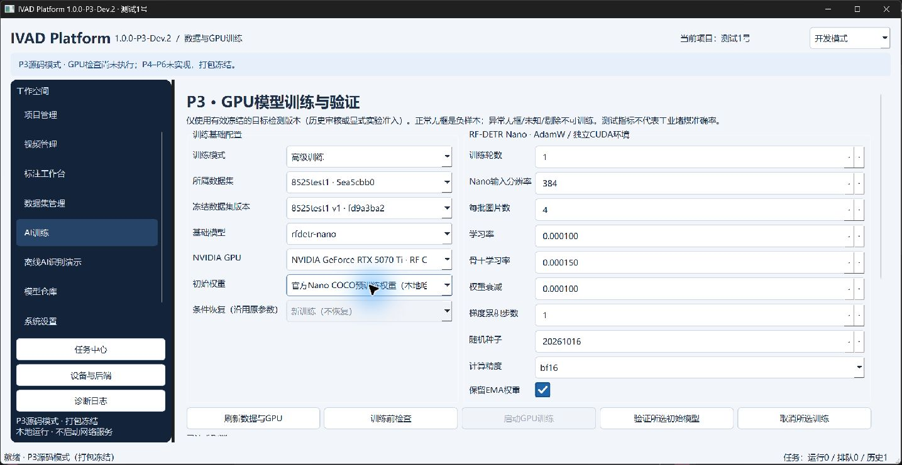
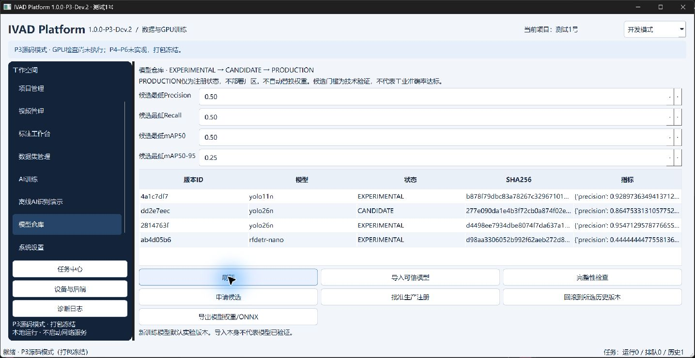
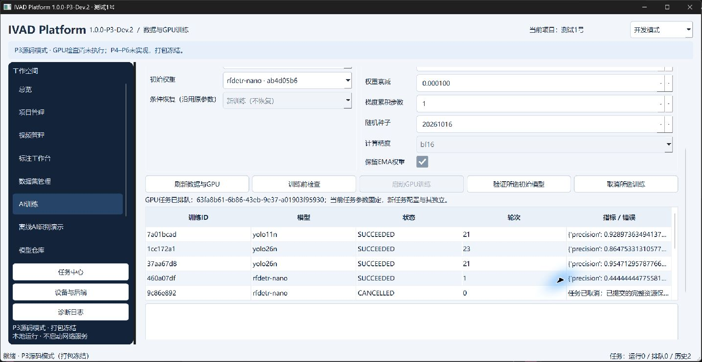
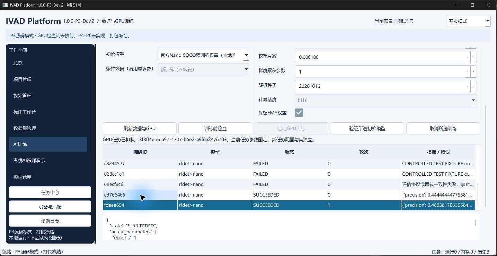
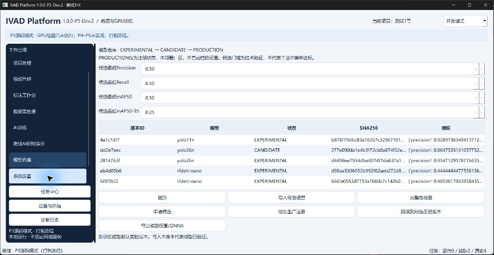

# P3.7-A RF-DETR训练正式接入验收

日期：2026-10-16。**阶段总体 PARTIAL**。RF-DETR Nano核心训练/数据/登记/重载/取消及A范围零Ultralytics路径已实测通过；原生Qt较大批次异常尚未归因，发行许可审计尚未闭合，不能提升为无保留PASS。未进入P3.7-B/P4，`PACKAGING_FREEZE=TRUE`。

## Git、边界与保护

开始时核对HEAD为 `b157e3e6be0cad9375917b88ab23927d060347d1`、分支 `feature/p36-rfdetr-evaluation`，无已跟踪改动/暂存改动，两份规划文件未跟踪。已创建 `feature/p37a-rfdetr-training`；原始 `nvidia-first` 保留在 `48f912734ecafa972b90c41d11b816100c962b73`。本轮成果本地提交哈希以最终回复及 `git log -1` 为准；没有push或远程上传。

两份未提交规划文件原样保留、未混入本次提交：`docs/P37_IMPLEMENTATION_PLAN.md`、`reports/P36_GIT_CLOSEOUT_AND_P37_PLANNING.md`，前后SHA均一致。实施前备份与清单 `artifacts/p37a-20261016/before`；只在 `artifacts/p37a-20261016/project-copy` 写业务数据。原项目不通过业务服务打开，不升级或重建其库。

原项目最终全表内容、1,578个训练/模型/冻结数据等保护文件与开始时一致，251张抽帧均与登记SHA相符。原库仍为0009：251帧、217标注、720修订、3摄像头、8媒体记录、1冻结版本、3原训练及3原模型。7个现存受管视频加1个可读原始来源共8个唯一文件与登记SHA匹配；部分旧original_path已不可读，另有一条开始即ERROR且无受管路径的媒体记录，只记录，不恢复/重写。没有本轮新增的源视频变更。证据 `integrity-result.json`、`media-protection.json`、`final-after/inventory.json`。

## 实际修改

| 模块 | 内容 |
|---|---|
| compute/model_adapters.py、rfdetr_contract.py | Nano能力及专属参数；预留Adapter扩展，不伪称Small已实现 |
| compute/rfdetr_probe.py、rfdetr_train_worker.py、rfdetr_evaluation.py、rfdetr_weights.py、gpu_lock.py | 独立CUDA探测/Worker、参数/权重布局/版本/物理UUID检查、两次规范评估及逐帧预测比对、共享GPU锁和取消 |
| services/training_router.py、rfdetr_training_service.py、core/application.py | 中立装配、RF业务路由、冻结数据预检、任务提交、真实日志/状态、成功模型登记；旧服务延迟导入且显式拒绝RF |
| datasets/rfdetr.py | IVAD冻结人工真值导出独立COCO+provenance，保留负样本与划分；不改原数据 |
| services/model_service.py、jobs/manager.py | PTH格式门禁、独立UUID/哈希/元数据，训练完成与登记同事务；提交完成后不被晚到取消误报；后台关闭等待子进程回收 |
| gui/training_page.py、training_controls.py、dataset_page.py | 原页面选择RF、专属简易/高级参数及中文Tooltip、真实BF16支持、预检/训练/取消/历史/日志；数据集兼容提示；修复定时刷新重建下拉菜单干扰选择 |
| 测试/文档/法律材料 | 针对性合约、数据、GUI、异常及进程树测试；5张真实GUI截图；Markdown说明和许可审计 |

没有数据库migration；没有新的主程序、标注页重构、RTSP、报警、正式离线RF迁移、驱动/全局Python改动或安装包。

## 数据与GPU实测

`示例数据集 v1` 原冻结版本 `fd9a3ba2-ed9b-4698-8838-5002b036fef0`：200图/402框/16正常，train160/331框/13正常、val40/71框/3正常、test0。manifest SHA `5eecfe2509b89dd67ec0ecf6280654607f036599099d538d305e27c27798a8ac`。原类别名“压滤版破裂”及UUID保留，不擅自改字；LIMITED与来源摄像头/视频/时间完整保留，没有重新划分。

RTX5070Ti16GB（驱动617.42），独立RF环境Torch2.9.1+cu128/CUDA12.8，真实CUDA张量、前向、梯度、参数更新均有证据。正式GUI操作：选择冻结集与Nano→训练前检查→启动GPU训练→成功记录→模型仓库→关闭/重开。最终1轮/40更新用时 **43.797秒**（含Worker初始化及规范评估，不是纯训练吞吐），峰值Torch allocated **2,170,979,840字节，约2.02GiB**；不冒充整机显存总占用。

最终TrainingRun：`fdeee654-0e2a-48a2-9c45-9abbcb2198ea`；新模型：`fd9f9bf2-3b69-45b9-b713-242c06783711`，EXPERIMENTAL；PTH SHA `666fa0553d7793a160dc7c142b21db70626a266f6a72854c66096fedd958fa43`。v2指标P=.4893617/R=.6478873/mAP50=.5496996/mAP50–95=.2185004，两次重载指标差0、40帧原始/后处理预测序列一致。此短训只验集成，不代表工业效果。

本轮有早期v1一轮服务短训、最终v2一轮GUI短训，以及一次训练中取消；**没有重复12轮P3.6实验**，没有重新运行完整P0或旧YOLO GPU训练。早期实验模型 `ab4d05b6-...` 保留，不冒称最终v2模型；原3个YOLO记录均保留。副本内5个模型及关联ONNX完整性检查通过，PTH模型工件导出哈希通过（不是应用安装包）。

## 测试矩阵

| 计划编号 | 结论 | 实际证据/限制 |
|---|---|---|
| A-T01 | PASS | 200/402/16与160/40/0、全部图片SHA、provenance保留；0/1基和非连续类别ID的转换及安装版RF loader真实映射；正常空annotations、越界/多边形/机器真值/冲突/异常无框拒绝 |
| A-T02 | PARTIAL | 真实Windows GUI简易/高级、参数、预检、提交、取消、日志、模型仓库和重启通过，5张截图；1920×1080逻辑布局及QT_SCALE_FACTOR=1.5原生RF测试通过。较大原生Qt测试批次出现COM/访问异常，尚未根因定位；不能据offscreen重跑将该异常抹除 |
| A-T03 | PASS | 可信P3.6权重真实CUDA加载；规范v2两次40图评估及完整逐帧预测一致；GUI一轮CUDA训练/保存/重载通过。详见评估报告 |
| A-T04 | PASS（已实现路径） | 独立UUID、SHA、数据/类别/参数/协议元数据，失败/取消不登记，缺失Run事务回滚，真实PTH/混合PTH与训练CKPT布局区分，导出不改扩展名，重启5模型可读 |
| AB-T05 | PASS（实际取消+控制故障测试） | 同GPU跨进程互斥、等待取消、队列取消、训练batch取消、运行中关窗取消、锁再获取；控制OOM/Worker崩溃/协议失败均不登记。实际OOM及GPU物理失效未制造，见NOT TESTED |
| AB-T06（A） | PASS | 未安装Ultralytics的独立环境，真实GPU路径loaded_modules无禁止项、旧PYTHONPATH隔离、显式污染负测试与失败分支不回退。旧系统整体及B范围不在本结论 |
| AB-T07 | PASS（保护与指定回归范围） | 原库全表/保护文件/251图/可读登记视频未变；冻结集、旧模型/训练保留。必要P1/P2/P3服务/GUI回归；没有重训旧模型 |

实际自动化日志（批次有重叠，不相加为独立测试数）：

- `regression-isolated.log`：**88 PASS，1 SKIPPED**；offscreen Qt回归，跳过旧测试要求的专用 `workflow-training-gui-20261016` 副本；本轮自己的真实200图计数/哈希已单独执行。
- `sealed-rf-tests.log`：最终 **26 PASS**，包括权重布局、矩形框真值预检、类别映射、布局、锁及仅停止自有进程树。
- `high-dpi-test.log`：2 PASS（含原生RF GUI布局），16项按选择条件未运行；不是多屏实机矩阵。
- `final-gui-contract-tests.log`：28 PASS，1 SKIPPED（同上述旧副本要求）；早期 `legacy-regression.log` 18 PASS。
- `failure-checks.json`：OOM/崩溃/协议差异是**明确受控注入**，不宣称发生过真实显存耗尽。
- `gui-close-check.json`：运行中真实验证任务 `0fe1d94a-...` 在关窗后CANCELLED、GUI进程exit0、GPU锁可再次取得、模型数量仍5；没有结束无关GPU进程。

原生批次失败日志 `regression.log` 原样保留，错误 `0x8001010d` / access violation；offscreen回归与独立原生RF GUI测试通过，但不足以证明该组合异常已修复。未无关重构Qt/数据库。

## 已知限制与NOT TESTED

RF Nano优化器断点续训尚未验收，GUI恢复入口禁用，取消CKPT保留；上游PTH可以附带优化器元数据，系统根据真实 `model` 权重布局区分，不仅看后缀。通用手工PTH导入未开放；本轮正式训练自动登记及已登记模型重新验证已实现。

NOT TESTED：真实耗尽16GB显存、物理GPU失效/驱动卸载、强杀真实GPU内核、跨机器/多GPU、混合多屏DPI、最终安装包Qt库替换、净机分发、RF离线视频及旧缓存隔离。控制故障/自有普通进程树测试不能冒充这些实机测试。

## 许可、后续阶段与停止

免费闭源审计 **PARTIAL / 分发BLOCKED**：RF本体与Nano资产路径已核实；Qt对应源码/最终替换验证、FFmpeg构建与codec授权、NVIDIA逐DLL再分发、部分缺失通知及GUI原包来源仍待闭合。完整表格见 `legal/P37_FREE_PROPRIETARY_LICENSE_AUDIT.md`、`P37_DEPENDENCY_SBOM.md`、`P37_DISTRIBUTION_OBLIGATIONS.md`。技术零依赖通过不等于全产品法律认证；未购买授权、未将IVAD整体开源、未删除旧声明。

P3.7-B具备复用RF权重/类别/独立环境与GPU锁的技术基础，但**尚未获得实施授权，未开始**；仍需单独完成视频推理、缓存隔离、导出及其验收。P4及安装包均未开始。当前停止并等待用户审阅PARTIAL及许可整改方案。

## 真实GUI证据

以下均为当前Qt GUI、同一独立项目副本的原始截图，无生成界面或人工预测框：

## 2026-10-19 收尾补充

当前基线与计数以2026-10-19实际快照为准；旧章节保留为2026-10-16历史证据。

日期：2026-10-19。基线 `1f1db7d338903d93a4add4f600dda11a5db5de00`，分支 `feature/p37a-rfdetr-training`。总体 **PARTIAL**，未认定Qt原始异常彻底解决。

`PACKAGING_FREEZE=TRUE`；`DISTRIBUTION_STATUS=BLOCKED`。无打包、push、环境安装、系统Python/驱动修改、YOLO重训或P3.7-B/P4实施。IVAD自研源码继续内部专有。

本轮本地证据目录：`artifacts/p37a-closure-20261019`。原生合并最终结果：**1 failed, 86 passed, 1 skipped in 104.62s (0:01:44)**。不修改旧测试断言，也不把这次回归写成全绿。

最终RF与清退专项同进程41 PASS（15.51秒），含最后的UNKNOWN任务门禁；中立预检兼容3 PASS、数据泄漏保护7 PASS、最终串行150% DPI专项1 PASS。批次存在重叠，不相加为独立用例数。真实缓存GUI补充验证已等到首帧解码，并完成逐帧、播放/暂停及安全关闭，不能仅以loaded标志代替画面证据。

| 验收领域 | 结果 | 证据与边界 |
|---|---|---|
| P3.7-A RF训练功能 | PASS | 沿用1f1db7d的真实GUI短训；本轮新队列/取消/历史测试、真实CUDA重载成功；未重复训练 |
| Qt原生GUI稳定性 | PARTIAL | 原始崩溃未归因；Windows原生单测/合并/重启/菜单压力测试通过相关操作，但有下述旧断言失败 |
| P2人工标注兼容 | PASS | box/polygon/ROI画布与P2真实GUI回归；原项目全表、251帧及所有保护文件不变 |
| P3 Native/COCO导出兼容 | PASS | 当前200图/402框/16正常副本两种导出校验；默认Native的原生GUI断言通过 |
| 训练历史清退 | PASS | 原项目3旧YOLO归档、2RF显示；合成夹具覆盖5种状态、项目切换、重新打开及队列取消 |
| Registry历史隔离 | PASS | 3旧模型归档、2RF显示；5模型及关联ONNX哈希验证；禁止旧模型登记/晋升/配置 |
| RF训练链路零Ultralytics | PASS | 本轮真实GPU重载、主进程导入阻断、Worker模块轨迹、隔离解释器及污染探针 |
| P3.5旧推理限制与保护 | PASS | 提交层/服务双重拒绝；5份完成缓存只读哈希验证；真实GUI历史缓存回放，未启动Worker |
| 全产品零Ultralytics迁移 | PARTIAL | 旧源码、环境、P0验证脚本和未来打包依赖仍保留；离线RF待B，不能声称发行闭包已无旧依赖 |
| 软件分发许可 | BLOCKED | 未完成Qt/FFmpeg/OpenCV/NVIDIA及部分通知/产权材料；保持冻结 |

## 未通过/未执行的测试

最终合并批次中的 `test_four_tabs_filter_sort_draft_batch_freeze_and_export` 仍要求默认产生 `*-yolo_detect-*`，本轮按要求实际默认产生Native，所以15秒等待失败。原断言及原始失败日志保留；新原生控件测试及真实200图服务导出验证Native/COCO行为。该旧测试未更新，因此整个旧回归集不是PASS。已有 `test_real_copy_200_restart_versions_and_training_picker` 缺少它专用的初始副本，沿用自身SKIP；本轮另行核实当前真实冻结集及原生重启，不将SKIP算作通过。

早期本轮日志包含服务预检错误和测试容器复用超时，分别通过修复中立预检兼容入口与修正重启夹具解决，所有日志保留。合并r2在进程运行期间源码修复，终版单独启动新进程复验，以final日志为准。

未制造真实OOM/驱动物理失效，未测试净机发行、最终Qt库替换、RF离线视频推理。本轮未新增训练梯度运行；训练CUDA证据沿用原P3.7-A，新GPU任务仅为已登记权重的两次规范验证。

## 当前数据与真实GPU证据

当前真实项目：5训练、5模型、217标注、721修订、251帧、3摄像头、8媒体记录、1冻结版本。不能沿用旧报告3训练/3模型/720修订当作当前基线。

`示例数据集 v1` / `fd9a3ba2-ed9b-4698-8838-5002b036fef0`：200图、402目标、16正常负样本，160/40/0划分；manifest SHA256 `5eecfe2509b89dd67ec0ecf6280654607f036599099d538d305e27c27798a8ac`。类别UUID、内部ID、矩形框合法性与Camera/Media/Frame关系均在独立副本核实；正常样本保留。Native及COCO export均实际执行、重新读取并计数200/402，原版本未改。

当前代码真实CUDA验证Job `8da15e9d-d101-482f-a529-d3a689bbb5cf`，TrainingRun `949dd493-6465-48f6-a976-0236d65d6bf6`，权重模型 `0d48a0e4-8fef-4ed9-953f-b84f9736976b`，最终 `SUCCEEDED`。40验证图，两次重载parity `PASS`；P/R/mAP50/mAP50–95为 `{'precision': 0.9285714030265808, 'recall': 0.5492957830429077, 'map50': 0.636925995349884, 'map50_95': 0.2698904871940613}`。这是现存模型的当前结果，不替换旧模型实验成绩。详细模块轨迹、GPU前向证据与预测SHA见 `data-final/project-copy/training/949dd493-6465-48f6-a976-0236d65d6bf6/result.json`。

2328个现存文件（含视频、缓存、权重、人工帧、冻结集、日志）前后SHA完全一致，全部SQLite表内容一致；251帧均匹配登记SHA。可读登记视频逐文件对照，缺失旧来源路径保留基线状态，不伪造恢复。两份用户已有未跟踪规划文档SHA不变且不提交。见 `before.json`、`after.json`、`integrity.json`、`provenance-check.json`。

## P3.7-B条件与停止

RF权重、显式类别映射、独立CUDA解释器、GPU锁、冻结数据转换及Registry已具备可复用基础。Qt原始异常仍需定位；旧回归中的默认YOLO断言需要单独审阅，不能据本轮声称无保留PASS。B仍需用户明确授权，才可实现独立RF离线Worker、缓存身份/隔离、导出及取消验收。本轮停止，不自动进入B/P4或打包。
