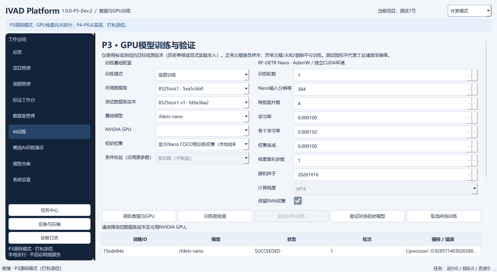
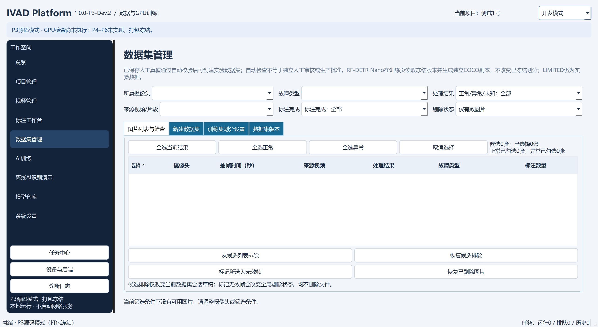
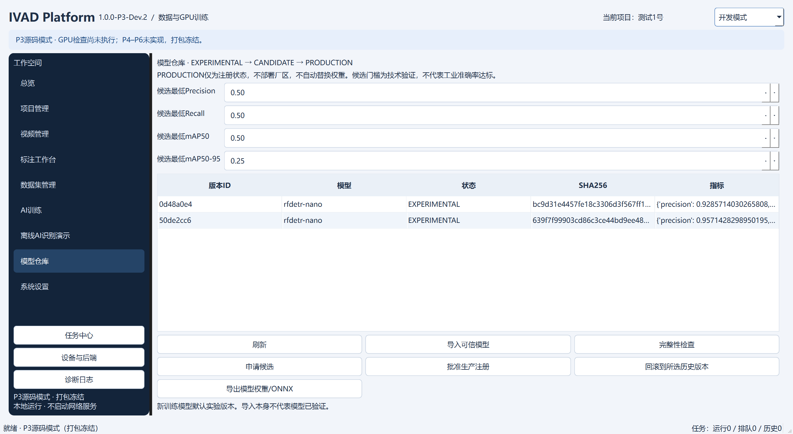
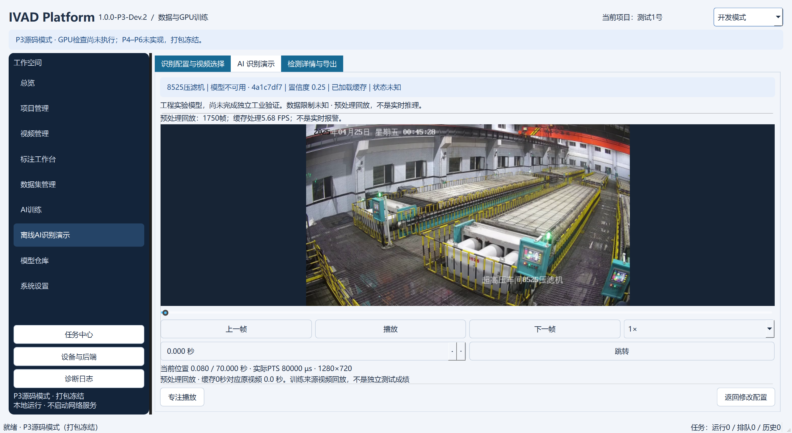

# P3.7-A Final Acceptance Closure

日期：2026-10-19。基线 `1f1db7d338903d93a4add4f600dda11a5db5de00`，分支 `feature/p37a-rfdetr-training`。总体 **PARTIAL**，未认定Qt原始异常彻底解决。

`PACKAGING_FREEZE=TRUE`；`DISTRIBUTION_STATUS=BLOCKED`。无打包、push、环境安装、系统Python/驱动修改、YOLO重训或P3.7-B/P4实施。IVAD自研源码继续内部专有。

本轮本地证据目录：`artifacts/p37a-closure-20261019`。原生合并最终结果：**1 failed, 86 passed, 1 skipped in 104.62s (0:01:44)**。不修改旧测试断言，也不把这次回归写成全绿。

最终RF与清退专项同进程41 PASS（15.51秒），含最后的UNKNOWN任务门禁；中立预检兼容3 PASS、数据泄漏保护7 PASS、最终串行150% DPI专项1 PASS。批次存在重叠，不相加为独立用例数。真实缓存GUI补充验证已等到首帧解码，并完成逐帧、播放/暂停及安全关闭，不能仅以loaded标志代替画面证据。

| 验收领域 | 结果 | 证据与边界 |
|---|---|---|
| P3.7-A RF训练功能 | PASS | 沿用1f1db7d的真实GUI短训；本轮新队列/取消/历史测试、真实CUDA重载成功；未重复训练 |
| Qt原生GUI稳定性 | PARTIAL | 原始崩溃未归因；Windows原生单测/合并/重启/菜单压力测试通过相关操作，但有下述旧断言失败 |
| P2人工标注兼容 | PASS | box/polygon/ROI画布与P2真实GUI回归；原项目全表、251帧及所有保护文件不变 |
| P3 Native/COCO导出兼容 | PASS | 当前200图/402框/16正常副本两种导出校验；默认Native的原生GUI断言通过 |
| 训练历史清退 | PASS | 原项目3旧YOLO归档、2RF显示；合成夹具覆盖5种状态、项目切换、重新打开及队列取消 |
| Registry历史隔离 | PASS | 3旧模型归档、2RF显示；5模型及关联ONNX哈希验证；禁止旧模型登记/晋升/配置 |
| RF训练链路零Ultralytics | PASS | 本轮真实GPU重载、主进程导入阻断、Worker模块轨迹、隔离解释器及污染探针 |
| P3.5旧推理限制与保护 | PASS | 提交层/服务双重拒绝；5份完成缓存只读哈希验证；真实GUI历史缓存回放，未启动Worker |
| 全产品零Ultralytics迁移 | PARTIAL | 旧源码、环境、P0验证脚本和未来打包依赖仍保留；离线RF待B，不能声称发行闭包已无旧依赖 |
| 软件分发许可 | BLOCKED | 未完成Qt/FFmpeg/OpenCV/NVIDIA及部分通知/产权材料；保持冻结 |

## 未通过/未执行的测试

最终合并批次中的 `test_four_tabs_filter_sort_draft_batch_freeze_and_export` 仍要求默认产生 `*-yolo_detect-*`，本轮按要求实际默认产生Native，所以15秒等待失败。原断言及原始失败日志保留；新原生控件测试及真实200图服务导出验证Native/COCO行为。该旧测试未更新，因此整个旧回归集不是PASS。已有 `test_real_copy_200_restart_versions_and_training_picker` 缺少它专用的初始副本，沿用自身SKIP；本轮另行核实当前真实冻结集及原生重启，不将SKIP算作通过。

早期本轮日志包含服务预检错误和测试容器复用超时，分别通过修复中立预检兼容入口与修正重启夹具解决，所有日志保留。合并r2在进程运行期间源码修复，终版单独启动新进程复验，以final日志为准。

未制造真实OOM/驱动物理失效，未测试净机发行、最终Qt库替换、RF离线视频推理。本轮未新增训练梯度运行；训练CUDA证据沿用原P3.7-A，新GPU任务仅为已登记权重的两次规范验证。

## 当前数据与真实GPU证据

当前真实项目：5训练、5模型、217标注、721修订、251帧、3摄像头、8媒体记录、1冻结版本。不能沿用旧报告3训练/3模型/720修订当作当前基线。

`8525test1 v1` / `fd9a3ba2-ed9b-4698-8838-5002b036fef0`：200图、402目标、16正常负样本，160/40/0划分；manifest SHA256 `5eecfe2509b89dd67ec0ecf6280654607f036599099d538d305e27c27798a8ac`。类别UUID、内部ID、矩形框合法性与Camera/Media/Frame关系均在独立副本核实；正常样本保留。Native及COCO export均实际执行、重新读取并计数200/402，原版本未改。

当前代码真实CUDA验证Job `8da15e9d-d101-482f-a529-d3a689bbb5cf`，TrainingRun `949dd493-6465-48f6-a976-0236d65d6bf6`，权重模型 `0d48a0e4-8fef-4ed9-953f-b84f9736976b`，最终 `SUCCEEDED`。40验证图，两次重载parity `PASS`；P/R/mAP50/mAP50–95为 `{'precision': 0.9285714030265808, 'recall': 0.5492957830429077, 'map50': 0.636925995349884, 'map50_95': 0.2698904871940613}`。这是现存模型的当前结果，不替换旧模型实验成绩。详细模块轨迹、GPU前向证据与预测SHA见 `data-final/project-copy/training/949dd493-6465-48f6-a976-0236d65d6bf6/result.json`。

2328个现存文件（含视频、缓存、权重、人工帧、冻结集、日志）前后SHA完全一致，全部SQLite表内容一致；251帧均匹配登记SHA。可读登记视频逐文件对照，缺失旧来源路径保留基线状态，不伪造恢复。两份用户已有未跟踪规划文档SHA不变且不提交。见 `before.json`、`after.json`、`integrity.json`、`provenance-check.json`。

## P3.7-B条件与停止

RF权重、显式类别映射、独立CUDA解释器、GPU锁、冻结数据转换及Registry已具备可复用基础。Qt原始异常仍需定位；旧回归中的默认YOLO断言需要单独审阅，不能据本轮声称无保留PASS。B仍需用户明确授权，才可实现独立RF离线Worker、缓存身份/隔离、导出及取消验收。本轮停止，不自动进入B/P4或打包。

## 修改文件

- `ivad_app/core/application.py`
- `ivad_app/gui/dataset_page.py`
- `ivad_app/gui/main_window.py`
- `ivad_app/gui/offline_demo_page.py`
- `ivad_app/gui/training_controls.py`
- `ivad_app/gui/training_page.py`
- `ivad_app/jobs/manager.py`
- `ivad_app/services/backend_policy.py`
- `ivad_app/services/model_service.py`
- `ivad_app/services/offline_demo_service.py`
- `ivad_app/services/rfdetr_training_service.py`
- `ivad_app/services/training_router.py`
- `ivad_app/services/training_service.py`
- `legal/ULTRALYTICS_ISOLATION_AUDIT.md`
- `reports/P37_A_ACCEPTANCE.md`
- `reports/P37_A_ACCEPTANCE_CLOSURE.md`
- `reports/P37_A_CLOSURE_assets/dataset.png`
- `reports/P37_A_CLOSURE_assets/models.png`
- `reports/P37_A_CLOSURE_assets/offline-history.png`
- `reports/P37_A_CLOSURE_assets/training.png`
- `reports/P37_A_QT_CRASH_INVESTIGATION.md`
- `reports/P37_LEGACY_TRAINING_ARCHIVE.md`
- `reports/P37_LEGACY_YOLO_RETIREMENT.md`
- `reports/P37_ZERO_ULTRALYTICS_DEPENDENCY.md`
- `scripts/p37a/closure_acceptance.py`
- `scripts/p37a/closure_environments.py`
- `scripts/p37a/closure_inventory.py`
- `scripts/p37a/closure_native.py`
- `scripts/p37a/closure_reports.py`
- `tests/test_p37a_retirement.py`

## 本轮真实GUI截图

以下截图来自独立项目副本；该截图会话显式关闭GPU探测，CUDA证据另见真实验证Job，不将空GPU选择器冒充CUDA测试。副本有原2条RF训练加本轮1条验证记录，故截图会话查询3条RF记录；原项目仍为2条。历史缓存模型显示不可用于新推理，回放仍为原模型UUID及缓存检测结果。

